# Mechanical Interface and Toolhead Design

## Table of Contents

- [Overview](#overview)
- [Mechanical Interface](#mechanical-interface)
  - [Interface Plate](#interface-plate)
  - [Z-Axis Mounting Interface](#z-axis-mounting-interface)
  - [Mounting Holes and Belt Attachment](#mounting-holes-and-belt-attachment)
  - [Toolhead Template](#toolhead-template)
  - [Standardized and Modifiable Geometry](#standardized-and-modifiable-geometry)
  - [Mounting Hardware](#mounting-hardware)
  - [Designing a Custom Toolhead](#designing-a-custom-toolhead)
  - [Clearance and Toolhead Movement](#clearance-and-toolhead-movement)
  - [Material and Manufacturing](#material-and-manufacturing)
  - [Example Toolhead: Pen Plotter](#example-toolhead-pen-plotter)
- [Electrical Interface](#electrical-interface)
  - [Electrical Connections and Available Resources](#electrical-connections-and-available-resources)
  - [Adding Sensors to a Toolhead](#adding-sensors-to-a-toolhead)
  - [Wiring and Cable Management](#wiring-and-cable-management)
  - [Toolhead Wiring and Connectors](#toolhead-wiring-and-connectors)
  - [Electrical Design Considerations](#electrical-design-considerations)
  - [Electrical Limitations](#electrical-limitations)
  - [External Power Supplies and Signal Connections](#external-power-supplies-and-signal-connections)
  - [Motors and Motor Control](#motors-and-motor-control)
  - [Toolhead Electrical Requirements](#toolhead-electrical-requirements)

## Overview

The OSHE Modular Gantry Toolhead Platform is designed to support interchangeable toolheads that can be used for different applications without requiring major modifications to the existing Pick-and-Place machine. This document establishes the mechanical and electrical interface requirements for designing and installing compatible toolheads.

The mechanical interface uses a standardized Interface Plate and Toolhead Template to provide a consistent mounting arrangement between the gantry and different toolheads. The dimensions and mounting features of these components are documented to ensure that new toolheads can be designed while maintaining compatibility with the existing machine.

The electrical interface provides a way to incorporate application-specific electronics into each toolhead. Using the BIGTREETECH Octopus Pro control board and the machine's existing wiring system, toolheads can be designed to include additional sensors, motors, and other electrical components as needed. Electrical requirements may vary depending on the application, so each toolhead must use connections and components that are compatible with the available power and signal interfaces.

This guide provides the dimensions, mounting requirements, electrical connections, and design considerations needed to develop a compatible toolhead. CAD files and design references are also available through the [OSHE Modular Gantry Toolhead Platform GitHub repository](https://github.com/GabrielFos/OSHE-Modular-Gantry-Toolhead-Platform).

The goal is to establish a consistent interface that allows different toolheads to be designed, installed, and exchanged while maintaining compatibility with the existing gantry system.

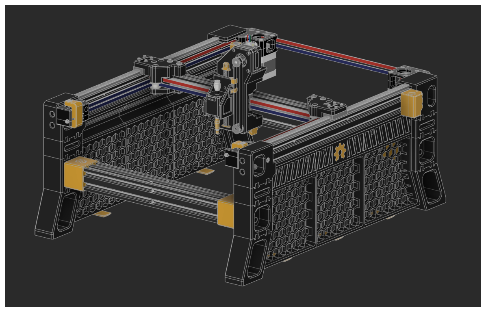

*Figure 1: Rendering of OSHE Pick-and-Place machine.*

# Mechanical Interface

## Interface Plate

The Interface Plate provides the mechanical connection between the gantry's Z-axis assembly and the interchangeable toolheads. It is designed to replace the existing Pick-and-Place toolhead mounting arrangement while maintaining compatibility with the machine's existing mounting features.

The overall mounting dimensions are based on the existing Pick-and-Place design. The main change is that the depth of the Interface Plate has been increased to 12.5 mm. This provides additional material for strength and space for an M3 heat-set insert used to attach the Toolhead Template.

All dimensions shown in the following figures are in millimeters (mm).

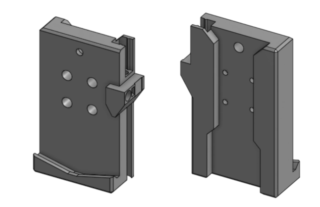

*Figure 2: Overall dimensions and views of the Interface Plate.*

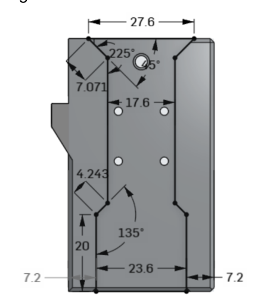

*Figure 3: Interface Plate profile and dimensions.*

Figure 2 and Figure 3 show the overall dimensions and profile of the Interface Plate.

## Z-Axis Mounting Interface

The side of the Interface Plate that attaches to the Z-axis rail must maintain the existing Pick-and-Place mounting geometry. This allows the plate to fit onto the existing gantry without requiring changes to the Z-axis assembly.

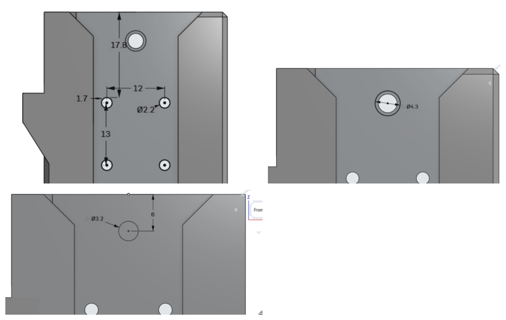

*Figure 4: Dimensions of the side that mounts to the Z-axis rail.*

The four mounting holes use M2 screws from the existing Pick-and-Place design. The groove that interfaces with the Z-axis rail must also remain unchanged to ensure proper alignment and attachment.

## Mounting Holes and Belt Attachment

The Interface Plate includes mounting holes and a heat-set insert location for attaching the Toolhead Template.

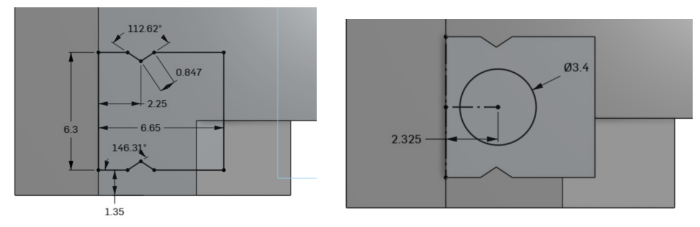

*Figure 5: Locations and dimensions of the mounting holes and heat-set insert hole.*

Figure 5 shows the locations and dimensions of the mounting holes and heat-set insert hole. The heat-set insert is designed for an M3 screw. The current design uses an insert approximately 4.55 mm in diameter and 5.7 mm long. The exact insert model should be verified when selecting the hardware.

The four M2 mounting holes, Z-axis rail groove, and belt attachment grooves and mounting features are required parts of the standardized mechanical interface. These features must not be changed when designing a compatible Interface Plate. Maintaining these dimensions allows the plate to attach to the existing gantry and use the machine's existing Z-axis drive system.

The Interface Plate also includes features for attaching to the Z-axis belt. These features are part of the existing Pick-and-Place mounting system and allow the belt to control the vertical movement of the toolhead.

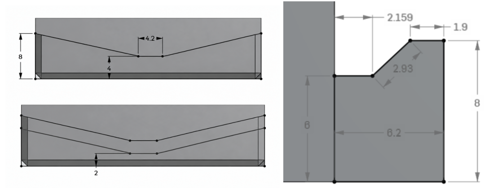

*Figure 6: Interface Plate rest.*

## Toolhead Template

The Toolhead Template provides a standardized starting point for designing interchangeable toolheads. It is designed to attach to the Interface Plate while providing a consistent mounting arrangement for different toolhead designs.

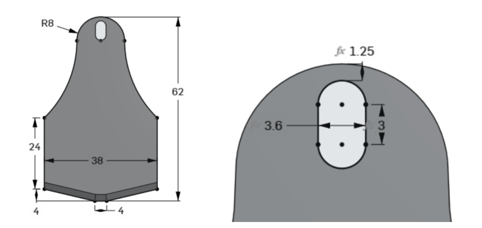

*Figure 7: Dimensions and mounting features of the Toolhead Template.*

The template is 4 mm thick and is designed to be simple so that it can be incorporated into many different toolhead designs. Its mounting geometry must remain compatible with the Interface Plate. The locations of the mounting features and the geometry that contacts the Interface Plate must remain aligned.

The remaining geometry can be modified to accommodate different applications. For example, additional material can be added to hold a tool, mounting holes can be added for sensors, or other features can be incorporated as needed.

The Toolhead Template is intended to establish the common mechanical connection between different toolheads and the gantry. A new toolhead should use this template as its starting point rather than creating a completely different mounting arrangement.

## Standardized and Modifiable Geometry

The mechanical interface contains features that must remain unchanged to maintain compatibility with the existing gantry. These include the four M2 mounting holes, the Z-axis rail groove, and the belt attachment grooves and mounting features on the Interface Plate. The mounting geometry of the Toolhead Template must also remain compatible with the Interface Plate.

Other features of the Interface Plate and Toolhead Template may be modified when necessary, provided that the required mounting geometry, alignment, and clearances are maintained. Custom toolheads can be modified to accommodate different tools, sensors, and other application-specific components.

## Mounting Hardware

The following hardware is used to assemble the existing mechanical interface. These specifications should be used as a reference when designing a compatible toolhead.

| Hardware | Application | Specification |
|---|---|---|
| M2 screws | Attach the Interface Plate to the Z-axis rail | Four screws; use the existing Pick-and-Place mounting arrangement |
| M3 screws | Attach the Toolhead Template to the Interface Plate | Approximately 15 mm overall length |
| M3 screws | Secure the pen holder in the example toolhead | Approximately 23 mm overall length |
| M3 heat-set inserts | Provide threaded mounting points in the printed parts | Approximately 4.55 mm outside diameter × 5.7 mm length |

The M3 screws use an Allen (hex) drive. Screw lengths and insert dimensions are based on the current design and should be verified against the hardware being used before manufacturing. Other toolheads may require different screw lengths depending on their geometry, provided the mounting interface remains compatible.

## Designing a Custom Toolhead

To create a custom toolhead, begin with the Toolhead Template and add the features required for the intended application. The standardized mounting geometry should be preserved so that the finished toolhead remains compatible with the Interface Plate.

The shape, size, and additional mounting features can be changed depending on the tool being used. However, the design must maintain the correct alignment and clearance around the mounting interface.

Toolheads will typically be oriented downward toward the work surface, but the design can be modified to position a tool horizontally or in another direction if the application requires it. Any changes in orientation should account for clearance and interference with the gantry throughout its range of motion.

Additional mounting features can also be included for sensors or other electronic components. These features should be positioned according to the requirements of the specific toolhead.

## Clearance and Toolhead Movement

When designing a custom toolhead, enough clearance must be maintained between the toolhead and the surrounding machine components. The toolhead should be checked throughout the full range of gantry and Z-axis movement to make sure it does not collide with the frame, work surface, wiring, or other machine components.

Clearance requirements will depend on the size, shape, and orientation of the toolhead. Designers should also consider the space needed for the tool or workpiece during operation. Any wires or cables attached to the toolhead must have enough flexibility and length to move with the gantry without becoming stretched, pinched, or caught.

The toolhead should be checked in the machine's CAD assembly before manufacturing. This helps identify possible interference and allows the design to be adjusted before the toolhead is installed.

## Material and Manufacturing

The current Interface Plate and Toolhead Template are 3D printed using PLA. Custom toolheads may also be 3D printed using PLA or another suitable material, depending on the requirements of the application.

When selecting a material, designers should consider the strength, stiffness, temperature, and durability requirements of the toolhead. The material and print settings should be appropriate for the forces and conditions expected during operation. If a toolhead will experience higher temperatures or mechanical loads, a different material or manufacturing method may be necessary.

## Example Toolhead: Pen Plotter

The pen plotter is an example of how the Toolhead Template can be modified to create a toolhead for a specific application.

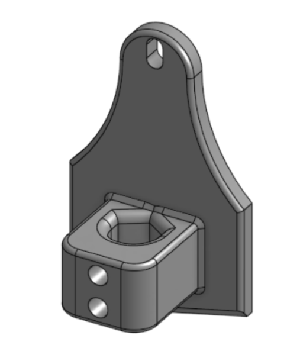

*Figure 8: The completed pen plotter toolhead.*

To create it, the Toolhead Template was used as the starting point, and additional material was extruded to create a section that holds a pen.

A hole was then added to allow the pen to slide into the toolhead. Figure 9 shows the dimensions of this opening.

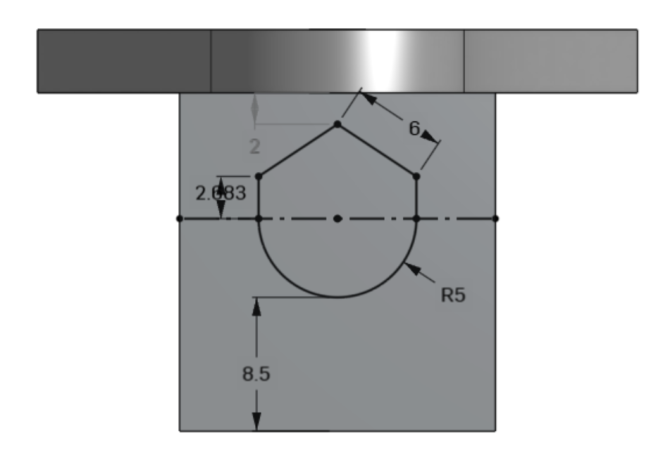

*Figure 9: Dimensions of the pen opening in the pen plotter toolhead.*

Additional holes were added for the M3 screws and heat-set inserts used to secure the pen. The screws used to hold the pen are approximately 23 mm long, measured from end to end. The screws used to attach the toolhead to the Interface Plate are approximately 15 mm long. Both use an Allen wrench. The finished design includes fillets to improve the appearance of the toolhead.

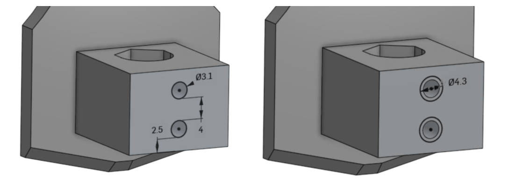

*Figure 10: Screw holes used to secure the pen holder and attach the toolhead.*

This example demonstrates how the standardized Toolhead Template can be modified to support different applications while maintaining compatibility with the existing mounting interface.

# Electrical Interface

## Overview

The OSHE Modular Gantry Toolhead Platform uses the BIGTREETECH Octopus Pro control board to manage the machine's electrical systems. The board provides several power and signal connections that can be used to support additional electronics on interchangeable toolheads.

The electrical interface is intended to allow toolheads to incorporate application-specific electronics, including sensors, motors, and other devices, without requiring major modifications to the machine.

Unlike the mechanical mounting interface, which uses standardized mounting dimensions, the electrical requirements may vary depending on the toolhead being installed. Each toolhead should only require the electrical connections necessary for its intended operation.

## Electrical Connections and Available Resources

The BIGTREETECH Octopus Pro provides several types of electrical connections that can be used when designing a toolhead.

These include:

- **Power connections:** Available voltage supplies can be used to power compatible sensors and electronic components.
- **Digital inputs and outputs:** General-purpose input/output (GPIO) connections can be used to read digital sensor signals or control external electronics.
- **I2C:** A communication protocol that allows multiple compatible devices to communicate over shared signal wires.
- **SPI:** A communication protocol commonly used for connecting sensors and other electronic modules.
- **UART:** A serial communication interface that can be used to exchange information with external devices.
- **Dedicated sensor connections:** The board also provides connections for temperature sensors, endstop switches, and proximity probes.

The exact connection used will depend on the electrical requirements of the device being installed. The Octopus Pro V1.1 pinout diagram in Figure 11 should be used to identify the available connections and their corresponding pin assignments.

## Adding Sensors to a Toolhead

The platform is designed to allow additional sensors to be incorporated into a toolhead when needed. There are currently no required sensors or standardized sensor configurations for all toolheads.

A sensor can be mounted directly to the toolhead using a custom mounting feature designed around the sensor's dimensions. This allows the sensor to be positioned appropriately for the toolhead's application.

Alternatively, a sensor can be mounted elsewhere on the gantry near the toolhead. Its wiring can then be routed through the machine's existing wire management system.

When selecting a sensor, the designer should identify:

- The required supply voltage.
- The sensor's current requirements.
- The type of output signal.
- The communication protocol, if applicable.
- The required connections to the control board.

Any additional circuitry needed to make the sensor compatible with the control board must be included in the toolhead's electrical design.

## Wiring and Cable Management

The existing Pick-and-Place machine includes a wire management system that can be used to route electrical connections throughout the machine. This system provides a way to organize and protect the wires running between the control board and the moving toolhead.

Braided cable sleeves are another option for organizing wires. A removable cable sleeve or similar system could allow users to add, remove, or replace wires when changing between toolheads with different electrical requirements.

The number and type of wires needed will depend on the toolhead being installed. For example, a toolhead that only requires power may need fewer connections than one that includes multiple sensors and communication interfaces.

Wiring should be organized so that it does not interfere with gantry movement. Appropriate strain relief and enough cable length should be provided to accommodate the full range of toolhead motion.

## Toolhead Wiring and Connectors

Electrical connections between the machine and each toolhead will use individual 1×1 Dupont female connectors at both ends of each wire. Each wire can be connected or disconnected individually, allowing the wiring arrangement to be changed when installing different toolheads.

The wires will be routed through the existing Pick-and-Place braided cable sleeve to keep them organized and protected while the gantry moves. Each wire will be labeled to identify its purpose and make it easier to connect the toolhead correctly. Connectors should be arranged and labeled clearly so that power, ground, and signal wires cannot easily be mixed up during installation.

This wiring arrangement allows different toolheads to use the electrical connections required for their specific applications. Wires can be added, removed, or rearranged when changing toolheads without requiring major changes to the machine's existing wiring system.

When assembling a toolhead, the wire labels and connection assignments should be checked to ensure that each wire is connected to the correct control-board pin and toolhead component. Power, ground, and signal connections must be identified correctly before the machine is powered on. Connectors and wires must be suitable for the voltage and current they will carry. Higher-current devices, such as motors, may require separate wiring and connections rated for their electrical requirements.

For low-current connections, such as many sensor and signal wires, 22 AWG or 24 AWG wire may be suitable. The wire gauge must be selected based on the current requirements, wire length, and allowable voltage drop of each application. Higher-current devices may require larger wires and appropriately rated connectors.

## Electrical Design Considerations

Each toolhead designer is responsible for ensuring that their electronics are compatible with the available electrical connections.

Before connecting a device, verify its operating voltage, current requirements, signal levels, and connector pin assignments.

The following considerations should be addressed:

- Do not exceed the voltage or current limits of the selected board connection.
- Ensure that sensor output signals are compatible with the control board's input voltage levels.
- Use appropriate signal conditioning or additional circuitry when required.
- Verify power and ground connections before applying power.
- Ensure that wiring is secured and cannot become caught during machine movement.
- Consult the Octopus Pro documentation before making changes to board wiring or jumper configurations.

The electrical connections used by each toolhead should be documented so that the toolhead can be installed and connected correctly.

## Electrical Limitations

The electrical capabilities of a toolhead are limited by the available connections and power supplied by the machine. The BIGTREETECH Octopus Pro provides several voltage outputs, signal connections, and communication interfaces. However, not every connection is suitable for every device.

When designing a toolhead, the following limitations must be considered:

- **Voltage compatibility:** The operating voltage of each device must match the voltage supplied by the selected connection. The signal voltage must also be compatible with the control board. For example, a 5V sensor output should not be connected directly to a 3.3V signal input unless the input is confirmed to be 5V tolerant or appropriate voltage conversion is provided.
- **Current limitations:** Each power connection has a maximum current rating. The current requirements of the toolhead must remain within the available capacity of the selected power supply and board connection. The total power used by the machine must also be considered.
- **Connection availability:** Some connections on the Octopus Pro are dedicated to specific functions, while others can be configured for different purposes. Connections already being used by the machine may not be available for additional toolhead electronics.
- **Additional circuitry:** Some sensors and electronic devices may require additional components, such as resistors, voltage regulators, signal converters, or driver circuits, before they can be connected to the control board.
- **External power supplies:** A toolhead may use an external power supply when the machine's available power connections are not suitable for its requirements. When external power is used, the electrical connections between the toolhead and control board must be designed to prevent incompatible voltage levels or unwanted current from entering the board.
- **Moving wires:** Electrical wiring must accommodate the full range of gantry and toolhead movement. Wires should be secured and routed so that they cannot become pinched, stretched, or caught during operation.

## External Power Supplies and Signal Connections

A toolhead may use an external power supply if the machine's available power connections are not suitable for its electrical components. When using an external supply, the designer must also consider how the toolhead's signal connections interact with the BIGTREETECH Octopus Pro control board.

If the toolhead receives control signals from the Octopus Pro while being powered by an external supply, the signal connections must use compatible voltage levels. The grounding arrangement must also be considered. In many cases, the external power supply and control board will need a shared signal ground so that control signals have a common reference. However, this depends on the circuit design and the type of interface being used.

The designer must make sure that connecting the external supply will not send an incompatible voltage or unwanted current into the control board. If necessary, additional circuitry such as voltage-level converters or signal isolation may be required. The power and signal wiring should be planned together before connecting the toolhead to the machine.

## Motors and Motor Control

Toolheads that use motors require additional electrical and mechanical planning. The motor must be compatible with the available power supply and the control method provided by the machine. Depending on the motor type, additional components such as a motor driver, controller, or external power supply may be required.

The designer must consider the motor's operating voltage, current requirements, and control signals. A motor should not be connected directly to a control-board signal pin unless that connection is specifically designed to drive the motor. The appropriate driver or control circuit must be used between the control board and motor when required.

Motor placement and movement should also be considered during mechanical design. The motor, its wiring, and any attached components must fit within the available space and must not interfere with the gantry or other machine components throughout the toolhead's range of motion.

## Toolhead Electrical Requirements

Each custom toolhead should have its electrical requirements documented before it is connected to the machine. The requirements will vary depending on the toolhead's application and the components it uses. The following table can be completed for each new toolhead.

| Requirement | Information to Document |
|---|---|
| Power source | Machine power, external power supply, or both |
| Operating voltage | Required voltage for each electrical component |
| Current requirements | Expected current draw of the toolhead |
| Sensors | Sensors used and the type of signal each one provides |
| Motors and actuators | Motor or actuator type, power requirements, and control method |
| Communication | Required communication interfaces, such as GPIO, I2C, SPI, or UART |
| Control signals | Signals the toolhead needs to receive from the control board |
| Outputs | Signals or devices the toolhead needs to control |
| Additional circuitry | Any required drivers, voltage regulators, level converters, or other interface circuits |
| Connections | Selected control-board pins, toolhead connections, and wire labels. Individual 1×1 Dupont female connectors are used at both ends of each wire. |
| Power consumption | Estimated total power required by the toolhead |

The completed table should identify the electrical resources needed by the toolhead and any additional hardware required. Actual control-board pin assignments and connections should be confirmed against the installed BIGTREETECH Octopus Pro V1.1 board and the machine's existing wiring before installation.

The Octopus Pro pinout diagram in Figure 11 provides a reference for identifying the board's connections. The pinout diagram shown is for the Octopus Pro V1.1. There is currently no single required electrical configuration for all toolheads. Each toolhead designer is responsible for selecting compatible components and documenting the connections required for their design. The wiring should be reviewed before connecting the toolhead to the machine to ensure that all voltage, current, and signal requirements are satisfied.

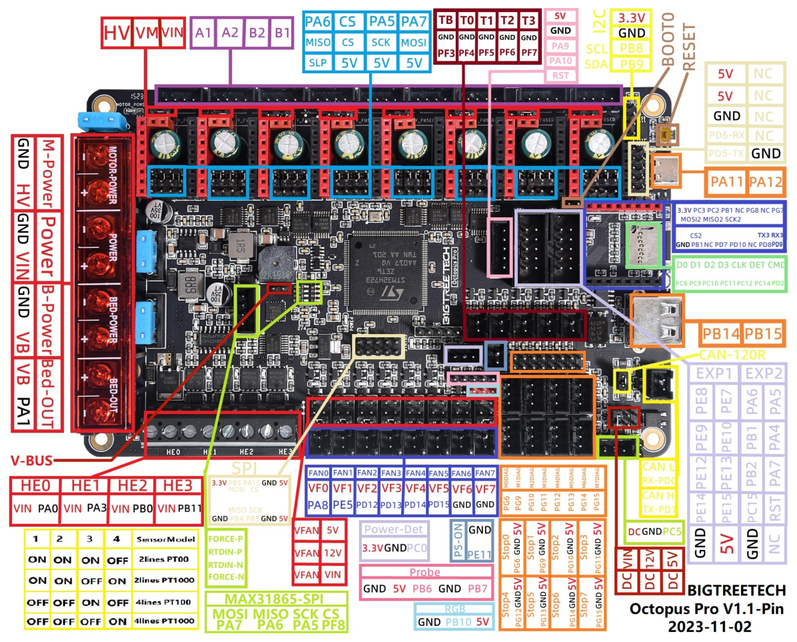

*Figure 11: BIGTREETECH Octopus Pro V1.1 pinout diagram.*

Source: [BIGTREETECH Octopus Pro GitHub repository](https://github.com/bigtreetech/BIGTREETECH-OCTOPUS-Pro).
